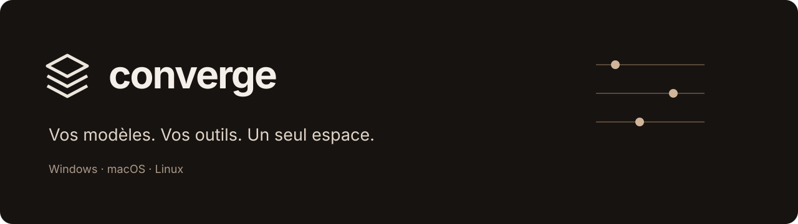
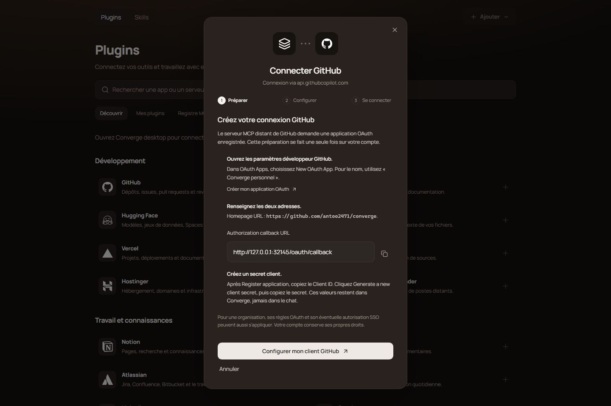
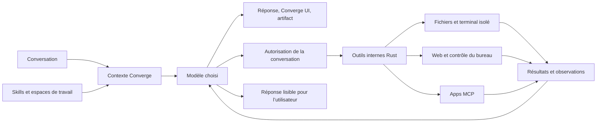

<p align="center"></p>

<p align="center">
  <a href="https://github.com/antoo2471/converge/actions/workflows/build.yml"></a>
  <a href="https://github.com/antoo2471/converge/releases/latest"></a>
  
  
</p>

Converge réunit vos modèles d’IA et vos outils dans une application desktop. Vous gardez le même fil de conversation en changeant de modèle, vous connectez vos apps par MCP et vous choisissez ce que l’IA peut lire, modifier ou contrôler.

[Téléchargements](https://github.com/antoo2471/converge/releases) · [Installation depuis les sources](#développer-converge) · [Connexions et skills](docs/extensions.md) · [Publier une release](docs/releases.md)

## Un espace de travail, plusieurs intelligences

L’application démarre sans fournisseur ni compte connecté. Ajoutez une connexion, choisissez un modèle, puis commencez à travailler.

| Dans le fil | Dans votre environnement |
|---|---|
| Réponses en streaming, Markdown, mathématiques et code | Fichiers, recherche dans les projets et modifications avec diff |
| Images et documents, collage et glisser-déposer | Terminal isolé avec sortie progressive et annulation |
| Édition, régénération et changement de modèle | Recherche Web et images, sans moteur à configurer pour commencer |
| Projets, branches, recherche et import/export | Apps MCP, ressources, prompts et bibliothèque de skills |
| Comparaison de modèles et effort de raisonnement | Contrôle du bureau avec indicateur visible et reprise par Échap |
| Interfaces interactives et artifacts HTML/React | Espaces de travail et autorisations propres à chaque conversation |

<p align="center"></p>

Le guide intégré vous accompagne dans la configuration de votre propre connexion OAuth, avec les adresses exactes à copier. La capture ci-dessus montre les composants réels de Converge, sans compte ni données de démonstration.

### Des réponses qui peuvent devenir des outils

**Converge UI** est un format déclaratif versionné, validé avant son rendu. Un modèle peut produire des formulaires, tableaux, graphiques ou simulateurs dont l’état évolue directement dans la réponse. Le rendu appartient à Converge : il ne dépend pas d’un fournisseur particulier.

Les **artifacts** prennent en charge les contenus HTML et React, avec code, prévisualisation et export. Ils sont servis depuis une origine dédiée et exécutés dans un iframe sandboxé, sans accès implicite aux commandes natives.

## Choisir ses connexions

Les modèles et les apps sont deux bibliothèques distinctes. Un modèle local peut utiliser un skill, appeler une app MCP ou travailler dans un dossier autorisé.

| Connexion de modèles | Usage |
|---|---|
| Local AI et Custom API | Ollama, LM Studio, llama.cpp et serveurs compatibles ; formats OpenAI ou Anthropic, URL, modèles, capacités et headers configurables |
| ChatGPT | Compte connecté via le transport Codex, streaming, efforts et outils Converge |
| Antigravity, Claude Code, Grok, Kimi, MiniMax | Clients officiels installés, avec profils propres à Converge |
| Z.ai / GLM et DeepSeek | Modes de compte ou d’API proposés par leur plugin |
| OpenCode Go / Zen | Clé et endpoint correspondant à votre offre |

Un client officiel doit être installé pour les connexions qui l’utilisent. Les capacités, quotas et modèles accessibles restent ceux de votre compte. Une clé API peut entraîner les frais de son fournisseur. [Détails des fournisseurs](docs/account-providers.md).

## Apps et skills

**Plugins** se trouve en haut de la navigation.

- **Découvrir** présente les apps par catégorie. Une connexion affiche son serveur et son mode d’authentification avant d’ouvrir le navigateur.
- **Mes plugins** permet de voir les outils réellement annoncés, reconnecter, déconnecter ou retirer une app.
- **Registre MCP** recherche dans le registre public officiel. Vous pouvez aussi ajouter votre propre serveur HTTP ou stdio.
- **Skills → Bibliothèque** recherche dans **skills.sh**, le catalogue utilisé par `npx skills`. L’installation importe uniquement le skill choisi et ses ressources ; elle n’exécute pas les scripts du dépôt.
- **Mes skills** regroupe les instructions installées. Les imports de dossier, SKILL.md et ZIP ainsi que la création manuelle restent disponibles.

Les apps Google sont séparées : Gmail, Drive, Docs, Sheets, Slides, Calendar, Chat, Contacts, etc. Les connexions officielles prises en charge proposent un parcours guidé : projet Cloud et API, client OAuth, puis connexion. GitHub possède également son tutoriel pour créer l’application OAuth et renseigner le callback.

Toutes les apps du catalogue n’ont pas un endpoint public officiel. Lorsqu’un connecteur tiers est nécessaire, Converge affiche son éditeur et vous laisse le choisir. Certains services exigent votre propre client OAuth ou une approbation de l’éditeur. [Guide des extensions](docs/extensions.md).

## Du contexte à l’action



Les outils sont internes : le modèle doit interpréter leurs résultats et vous donner la réponse demandée. Un appel exécuté dans le raisonnement n’est pas un appel exécutable ; le modèle doit utiliser le protocole d’outils en dehors de son raisonnement.

Les sessions Antigravity et Claude Code restent ouvertes entre les tours d’outils, avec un contexte incrémental. Elles sont séparées par connexion, conversation, modèle et effort, et sont abandonnées si l’historique est édité ou si la session échoue. Une session inutilisée libère son processus après deux minutes.

## Installer

Récupérez l’installateur correspondant à votre processeur dans [Releases](https://github.com/antoo2471/converge/releases).

| Système | x64 / AMD64 | ARM64 |
|---|---|---|
| Windows 10/11 | `.exe` NSIS | `.exe` NSIS |
| macOS 12.3 ou supérieur | `.dmg` Intel | `.dmg` Apple Silicon |
| Linux, base Ubuntu 24.04 ou compatible | `.deb` et `.AppImage` | `.deb` et `.AppImage` |

Sur Linux, les outils natifs utilisent WebKitGTK 4.1 et le coffre Secret Service du bureau. Le terminal isolé nécessite **bubblewrap**. Le contrôle du bureau utilise **X11** et **wmctrl**. L’application peut s’ouvrir sous Wayland, mais le contrôle global du bureau y est explicitement refusé par cet adaptateur.

Sur macOS, autorisez **Accessibilité**, **Enregistrement de l’écran** et, lorsqu’il est demandé, le contrôle par **Automatisation**. La protection de macOS peut demander de confirmer l’ouverture d’une application signée ad hoc. Les distributions Windows peuvent afficher SmartScreen sans certificat de signature de code. Les commandes PowerShell isolées nécessitent une installation récente de **PowerShell 7** ; les commandes cmd et Node n’en dépendent pas.

Les mises à jour sont vérifiées en arrière-plan depuis ce dépôt. **Paramètres → Mises à jour** permet aussi une vérification manuelle. Une installation demande de terminer les tâches en cours ; le bouton **Installer et relancer** vérifie la signature avant d’appliquer la release.

## Données et permissions

Les conversations, projets, préférences et références d’extensions sont stockés localement dans SQLite. Les clés API, secrets et jetons MCP sont conservés dans le coffre du système ; les identifiants des clients officiels restent dans leurs profils dédiés. Les exports de conversations n’embarquent pas ces secrets.

Les connexions OAuth existantes sont restaurées au démarrage sans ouvrir le navigateur. Un compte révoqué ou un coffre verrouillé peut demander une reconnexion. Déconnecter ou retirer une connexion reste une action explicite.

Vous choisissez les dossiers depuis **+ → Espace de travail**. Chaque conversation peut en utiliser plusieurs. Un nouveau dossier demandé par l’IA est proposé avant son ajout. Les permissions permettent d’autoriser une action, de refuser ou d’autoriser les prochaines actions de cette conversation.

| Exécution | Protection |
|---|---|
| Terminal Windows | AppContainer, sans réseau ; PATH installé conservé, accès lecture/exécution aux runtimes nécessaires |
| Terminal Linux | Espaces de noms et montages bubblewrap, sans réseau |
| Terminal macOS | Profil Seatbelt via sandbox-exec, sans réseau |
| Commande en lecture seule | Dossier approuvé monté ou autorisé en lecture seule |
| Commande avec modifications | Copie de travail isolée ; application des changements soumise à autorisation |
| Artifacts | Origine dédiée et iframe sandboxé |
| Serveur MCP stdio | Processus local avec les droits de votre utilisateur ; choisissez un serveur de confiance |

Le contrôle du bureau agit sur vos vraies fenêtres. L’indicateur **Converge a le contrôle** reste affiché entre les actions et pendant les réponses du modèle. **Échap** ou le bouton d’arrêt interrompent le contrôle. Des limites de répétition, d’observations sans action et d’échecs empêchent un tour de tourner indéfiniment. Une capture après chaque action permet de vérifier le résultat ; les captures anciennes sont rejetées lorsque la fenêtre a changé.

Les données transmises à un modèle ou à une app quittent votre machine vers la connexion choisie. Vérifiez les autorisations des apps et des skills avant de leur confier des données sensibles. Les noms et logos des fournisseurs n’impliquent aucune affiliation.

## Développer Converge

Prérequis communs : **Node.js 24**, Rust stable et les [dépendances Tauri de votre OS](https://v2.tauri.app/start/prerequisites/). Pour Windows, installez les outils C++ MSVC et WebView2. Pour macOS, les outils de ligne de commande Xcode. Les paquets système Linux du workflow sont listés dans [build.yml](.github/workflows/build.yml).

```sh
npm ci
npm run desktop
```

`npm run dev` démarre uniquement le frontend dans le navigateur. Les connexions, les permissions, le coffre et les outils nécessitent l’application desktop.

```sh
npm test
node --test scripts/release-version.node-test.mjs
cargo test --manifest-path src-tauri/Cargo.toml --lib
npm run build
npm run tauri build
```

Les tests interactifs ou nécessitant un compte sont désactivés par défaut et indiquent leur prérequis. Aucun test standard ne connecte un compte, ne consomme un tour d’inférence ou ne lit votre messagerie.

### Organisation du code

| Dossier | Responsabilité |
|---|---|
| `src/core` | Conversations, contexte, préférences et orchestration des outils |
| `src/generative` | Schéma, état et rendu de Converge UI |
| `src/components` | Interface, fournisseurs, extensions et paramètres |
| `src-tauri/src/extensions` | MCP, OAuth, coffre, skills et catalogue skills.sh |
| `src-tauri/src` | Fournisseurs, outils, permissions, persistance, sandbox et plateformes natives |
| `.github/workflows` | Vérifications, six distributions et publication signée |
| `scripts` | Préparation des artifacts, versionnement et outils de release |

## Releases et contributions

Le numéro suit **année.mois.numéro de release du mois** : `26.10.1`, `26.10.2`, puis `26.11.1`. Le workflow **Publish release** alloue ce numéro et synchronise les manifestes. Les releases sont publiées seulement après la réussite des six builds. [Procédure et secrets de signature](docs/releases.md).

Pour signaler un problème, joignez le système, l’architecture, la version de Converge, la connexion utilisée et des étapes de reproduction. Retirez les clés, cookies, tokens et données privées des journaux. Ne mettez jamais la clé de signature updater dans un commit.

Le dépôt ne définit pas encore de licence générale pour le code de l’application. Les ressources tierces conservent leurs licences et attributions : [logos](src/assets/brands/README.md). La direction visuelle est documentée dans [DESIGN.md](DESIGN.md).
